# Mibo

**デスクトップに住む AI コンパニオン。そばにいて、用事もこなします。**

独自の姿と性格を持つキャラクターが会話し、利用者のことを記憶し、見る価値のあるものを一度にひとつ届けます。会話だけではありません。ウェブを閲覧し、コンピューター上の他のプログラムを操作し、ファイルとコマンドを扱い、スキルと MCP コネクタを使い、予定されたタスクを実行します。利用者のコンピューター上で、利用者が選んだモデルサービスを使って動作します。操作は自動で審査され、利用者の判断が必要なときだけチャットで確認します。同意すると、そのタスクは最後まで実行されます。支払い、削除、アカウントの変更は個別に確認します。

[](https://github.com/wangkant/mibo/actions/workflows/ci.yml)
[](https://github.com/wangkant/mibo/releases/latest)
[](../../LICENSE)

[English](../../README.md) · [简体中文](../../README.zh-CN.md) · [繁體中文](README.zh-TW.md) · **日本語** · [한국어](README.ko.md) · [Español](README.es.md) · [Français](README.fr.md) · [Deutsch](README.de.md) · [Português (Brasil)](README.pt-BR.md) · [Русский](README.ru.md)

<p align="center"></p>

## 機能

| 分野 | |
|---|---|
| **会話** | ひとりのキャラクターがウィンドウに登場し、Windows ではデスクトップ上にも姿を見せます。内蔵キャラクターまたは独自のキャラクターを使用できます。OpenAI 互換のモデルサービスのほか、コンピューター上の Ollama と LM Studio に対応します。モデルメニューにコンテキスト使用率が表示され、「今すぐ要約」と「コンテキストをクリア」を使えます。 |
| **記憶** | 利用者に関する事実と予定を日付付きで記録し、「設定 › 記憶」で確認・編集できます。身分証番号、カード番号、パスワード、認証コードは保存しません。一時チャットは記録を残しません。 |
| **おすすめ** | 公開された情報源から一度にひとつずつ届け、クリック数ではなく閲覧時間で順位を決めます。各カードには理由が示され、フィードバックと取り消しに対応します。 |
| **外出** | 公開ページを訪問者として、サインインせずに巡回し、robots.txt に従います。ページは見出しや表を保ったまま一度に読み取ります。ウェブ検索にキーは不要です。 |
| **内蔵ブラウザー**（Windows） | リンクは会話の横で開き、タブ、プライベートタブ、ダウンロードに対応します。キャラクターはページを確認し、クリック、入力、選択、ドラッグ、ファイルのアップロードを行います。 |
| **他のプログラム**（Windows） | UI Automation で他のプログラムのウィンドウを読み取り、操作します。Electron アプリにも対応し、利用者がキーボードとマウスを使っていないときだけ操作します。 |
| **ファイルとコマンド** | 利用者自身のデスクトップ、ドキュメント、ダウンロード、ピクチャ、ミュージック、ビデオと、許可したフォルダーに限られます。コマンドは実行前に解析され、各ターンのファイル変更は元に戻せます。Windows では削除したファイルはごみ箱に移ります。 |
| **スキルとコネクタ** | スキル（`SKILL.md` を含むフォルダー）と MCP サーバー。それぞれ厳選されたマーケットがあります。メッセージの先頭に `/name`（スキル名）と書くと、そのスキルを使い始めます。 |
| **スケジュールタスク** | リマインダー、タスク、定期的な条件チェック。実行時は読み取りと、タスク作成時に許可した操作のみを行います。 |
| **言語** | 10 か国語のインターフェース。 |

## キャラクター

<p align="center"></p>

<p align="center">Mibo · 白竜 · おさかな · お嬢様</p>

## インストール

[最新リリース](https://github.com/wangkant/mibo/releases/latest)からダウンロードしてください。インストーラーにはコード署名がないため、初回起動の前にシステムが警告を表示します。

| システム | ファイル | 初回起動 |
|---|---|---|
| Windows 10 / 11（x64） | `mibo-0.1.0-setup.exe` | ブラウザーがファイルについて警告した場合は「保存」を選びます。SmartScreen に「Windows によって PC が保護されました」と表示されたら、「詳細情報」を選び、「実行」を選びます。インストールは現在のアカウントのみに行われ、管理者権限は不要です。 |
| macOS（Apple シリコン） | `mibo-0.1.0-macos-arm64.dmg` | ディスクイメージを開き、`mibo.app` を「アプリケーション」フォルダーにドラッグします。アプリは公証されていないため、初回は開けません。メッセージを閉じてから、「システム設定 › プライバシーとセキュリティ」で「このまま開く」を選んで確定します。 |

新しいリリースも同じ方法で上書きインストールします。アンインストールしてもデータフォルダーは残ります。

### インストーラーを使わない場合

| | |
|---|---|
| **Windows ポータブル版** | `mibo-0.1.0-windows-x64.zip` をダウンロードし、任意の場所に展開して `mibo.exe` を実行します。このファイルもコード署名されていません。 |
| **Scoop**（Windows） | `scoop bucket add mibo https://github.com/wangkant/scoop-mibo` を実行し、続けて `scoop install mibo` を実行します。 |
| **Homebrew**（macOS、Apple シリコン） | `brew install --cask wangkant/mibo/mibo` を実行します。 |
| **Python でインストール**（3.10–3.14、すべての OS） | `pipx install "mibo[app,web]"` または `uv tool install "mibo[app,web]"` を実行し、続けて `mibo` を実行します。 |

### ソースから実行（Linux と開発）

Python 3.10–3.14 が必要です。

```bash
git clone https://github.com/wangkant/mibo
cd mibo
python -m pip install -e ".[app,web]"
mibo
```

`app` は macOS と Linux でウィンドウ部品を、`web` は外出に使う Playwright を追加します。開発には `".[dev]"` をインストールし、`python -m pytest -q` を実行します。詳しくは [CONTRIBUTING](../../.github/CONTRIBUTING.md)（英語）を参照してください。

## 初回起動

1. 言語、キャラクター、モデルを選び、続いて興味のあるトピックと簡単な自己紹介を入力します。
2. モデルは、サービスを選んでキーを貼り付けるか、OpenRouter にサインインして無料モデルを使うか、起動中の Ollama または LM Studio を選びます。
3. キーはシステムの資格情報ストア（Windows 資格情報マネージャー、macOS キーチェーン、Linux の Secret Service）に保存され、ファイルには書き込まれません。資格情報ストアのないシステムでは、現在のアカウントだけが読める `credentials.json` に保存され、「設定 › このコンピューター」にその旨が表示されます。

データはひとつのフォルダーにまとめて保存されます。インストール版は `~/mibo`、ソースから実行した場合はクローンしたフォルダー自体、または `mibo --home DIR` で指定したフォルダーです。設定はそのフォルダーの `settings.json` に保存されます。Mibo は初期設定でサインイン時に起動し、「設定 › このコンピューター」でオフにできます。

## プライバシーと安全性

| | |
|---|---|
| **モデルサービス** | メッセージ、関連する記憶、返答に使うページやファイルの内容、審査で判断する操作手順を受け取ります。キーはこのサービスにのみ送信されます。 |
| **ウェブサイト** | 外出ではサインインせずに公開ページを読み、初期設定では 1 日 3 回です（「設定 › 外出」）。返答には必要なページを読みます。サインイン情報は内蔵ブラウザー内にとどまり、そこでのみ使われます。 |
| **その他のサービス** | 返答に検索が必要なときの検索語、1 日 1 回までの GitHub へのバージョン番号の送信、マーケットを開いたときのカタログ照会、MCP サーバーのツールに渡す内容。 |
| **毎回確認** | 支払いや購入、削除、アカウントのセキュリティやアクセス権の変更は、どのモードでも確認します。ほかの種類の操作への同意はこれらには及びません。銀行、決済、医療、メールのサイトでは、すべての操作を確認します。チャット欄に利用者自身が入力したメッセージだけが同意になります。 |
| **行わないこと** | パスワード、支払い情報、認証コードの読み取りと入力。管理者権限での実行。セキュリティ設定の変更。 |
| **無人での実行** | 外出と、利用者が作成したスケジュールタスクのみです。 |

すべての送信先と各データの保存場所は [SECURITY](../../.github/SECURITY.md)（英語）に記載しています。

## 動作環境

| | Windows | macOS | Linux |
|---|---|---|---|
| **インストール** | インストーラー | ディスクイメージ | ソースから実行 |
| **システム** | Windows 10 / 11、x64 | Apple シリコン | Python 3.10–3.14 |
| **内蔵ブラウザー、他のプログラム、デスクトップの姿** | 対応 | 非対応 | 非対応 |
| **外出** | 標準搭載の Edge | Edge、Chrome または Chromium | Edge、Chrome または Chromium |
| **モデル** | OpenAI 互換のモデルサービスとそのキー、またはローカルのモデルサーバー | 同左 | 同左 |

## ライセンス

[Apache License 2.0](../../LICENSE)。第三者のコードはそれぞれのライセンスに従います（[NOTICE](../../NOTICE)）。キャラクターの立ち絵は CC BY-NC-SA 4.0 です（[詳細](../../mibo/static/characters/LICENSE.md)）。[免責事項](../DISCLAIMER.ja.md)と[変更履歴](../../CHANGELOG.md)（英語）も参照してください。
